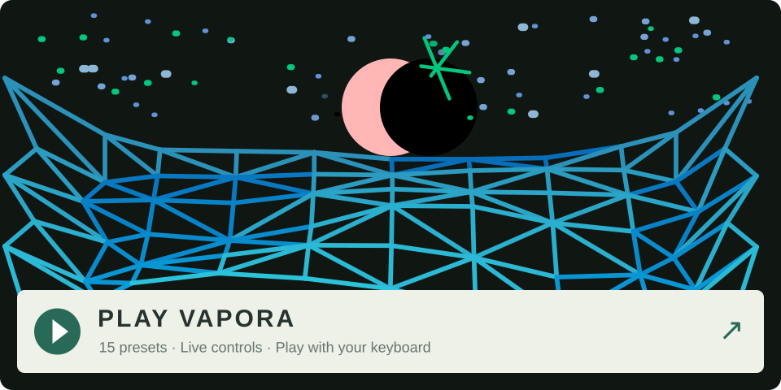

# VAPORA

Cinematic pads and spectral textures for the original OP-1, built for Hundekraft.

**A reworking of [PADsynth](https://zynaddsubfx.sourceforge.io/doc/PADsynth/PADsynth.htm), the synthesis algorithm by Nasca Octavian Paul, for the original OP-1.**

-

-

## Play VAPORA in your browser

**[Open the playable preview →](https://aiaaaa.github.io/vapora/)**

Play the actual VAPORA engine and animated screen with your keyboard or touch, explore all 15 presets, and save browser patches. Click **Enable audio** to begin. No OP-1 or installation required.

The preview uses a browser audition envelope; saved Plate/Reverb effects and other OP-1 processing are not included. [Preview SDK and build instructions](preview-sdk/README.md).

## Overview

VAPORA is a six-voice PADsynth-based instrument with two independently phased, detuned playback heads per voice, 14 sound characters, and 15 curated presets. Its screen combines a moving triangular perlin space, stars, and a setting sun.

Two detuned playback heads read broad, evolving PADsynth spectra for each note. Morph between two related colors, add a pitched interval, and let the tone drift. Fourteen characters cover warm ensembles, breathy choirs, hollow flutes, glassy textures and deep drones. VAPORA plays up to six notes, follows velocity, and uses the OP-1’s normal T2 envelope and T3 effect.

## Manual

**Shift** button will toggle a on screen active variable readout, can be helpful at first TRY IT!

**Load:** press **synth**, then **Shift + T1**. Turn **blue** to **vapora** and press **T1**. To load a factory sound, open the preset browser with **Shift + a sound key**, choose **vapora**, then the preset.

### Controls

| Encoder | Turn | Push, then turn |
| --- | --- | --- |
| **Blue** | **Morph, 0–100%:** blend between the two spectra of the current character. Different positions can sound warmer, airier or more textured. Morph also adjusts wave movement. | **Character:** select one of 14 sound families, each with its own wave style. |
| **Green** | **Thickness, 0–100%:** increase detuning and the contribution of the second playback head. Low settings are more focused; higher settings add beating and fullness. The signature star rotates 360° and grows up to 60%. | **Interval:** choose the second head’s pitch relative to the played note, plus its added star field and signature. |
| **White** | **Brightness, 0–100%:** open the tone filter and raise the sun. | **Sun:** each push advances to the next design. Turning white still edits Brightness. |
| **Orange** | **Motion, 0–100%:** add slow movement to the sound’s morph, detune and brightness; set how far the sun pulses from white toward red-orange. | **Speed, about 0.02–2 Hz:** set the rate of the internal movement and the sun’s pulse. |

Push blue, green or orange again to return to its main control. Each has its own selection. White does not have a push then turn setting due to current SDK setup.

**Characters:** Warm, Swarm, Breath, Flute, Pressure, Surf, Porcelain, Sub, Velvet, Cathedral, Nebula, Aurora, Oceanic and Glassveil. Morph explores the two endpoints within a character; use Character for a larger change in sound.

**Shift:** toggle the bottom control dial/readout on and off. It starts hidden and stays in the chosen state after release. The black backing appears only when shown; waves continue into that area when hidden. The choice lasts for the session, not across a fresh plugin load or in saved sounds.

**Intervals:** octave below, fifth below, unison, minor third, major third, fifth, major sixth, minor seventh, major seventh and octave above. Start with unison for a conventional pad; a fifth or octave adds a second pitch to each played note.

### Try this

Load STONE HALL and play it at -3 octave range.

### Presets and saving

The factory bank contains 15 sounds: A Fifth Tide, Asteroid Swarm, Breath Choir, Cavern Flute, Deep Pressure, Holy Dust, Ice Chapel, Last Light, Moon Choir, Pink Surf, Porcelain Orbit, Stone Hall, Sub Lantern, Tidal Arc and XFIN.

Save an edited sound with the OP-1’s usual sound-key gesture. Deep Pressure saves Reverb enabled. Stone Hall starts at octave −3 and saves Plate enabled with **Decay 99, Pre 99, Tone 00, Mix 33**. The other thirteen presets are dry.

## Download and install

- [VAPORA 1.2.4 plugin](downloads/vapora.knl)
- [15 factory presets](downloads/vapora-core15-presets.zip) — for new installations
- [Stone Hall preset update](downloads/vapora-stone-hall-plate.zip) — replace only Stone Hall in an existing bank
- [Checksums](downloads/SHA256SUMS)

Requires the **original OP-1 with Hundekraft 3.0.2**. This is not an OP-1 field plugin.

Open the [Hundekraft Workshop](https://hundekraft.github.io/op1-workshop/), add `vapora.knl` under **Your plugins**, connect the instrument, and use **Update OP-1**. Follow the Workshop’s transfer/restart instructions.

For a new installation, unzip the preset pack and copy its `synth/vapora` folder into the instrument’s `synth` folder in normal disk mode. Eject and allow synchronization to finish. If upgrading from 1.2.3, **update only the plugin; keep all presets**. If upgrading an older installation that lacks the Stone Hall update, **update the plugin and replace only `synth/vapora/stone hall.aif`** from the Stone Hall update. Keep the other fourteen presets. Eject, allow synchronization to finish, then reload Stone Hall. Keep a copy first if you edited your existing Stone Hall.

Deep Pressure uses the separate Hundekraft `reverb` effect; Stone Hall uses `plate`. Install those effects to use their saved settings. The OP-1 supplies the T2 envelope and optional T3 effect.

## Build and validation

[Build instructions](docs/BUILD.md) include the pinned SDK, Blackfin toolchain and host checks. All corresponding plugin source, generators, editable geometry and preset recipes are in [plugin/vapora](plugin/vapora).

Native Blackfin compilation, package/import/relocation checks and sanitizer host checks passed. The output-level sweep covers 13,440 six-voice cases with no clipped samples and about 1.9 dB headroom in the loudest tested dry sum. Geometry, Shift behavior, spreading impacts, stars and all seven suns are checked on the host. Controlled device CPU/GUI timing and Stone Hall’s Plate/octave save-and-reload check remain pending. Host audio fixtures do not render the saved effects.

The existing images and GIFs are retained. They are host renderings, not OLED captures.

[Release notes](CHANGELOG.md) · [Validation records](validation) · [Hundekraft handoff notes](docs/HUNDEKRAFT.md)

### Version notes

**Version 1.2.4** adds green line-art signature stars and smoother background-star movement, with small stars drifting at 37.5% of the larger stars' speed. The original blue waves, sound, presets and Shift readout are unchanged from 1.2.3. Existing 1.2.3 users update only the plugin.

**Version 1.2.3** raises VAPORA’s fixed output gain by 3× to match Stock synth output levels (about +9.54 dB), keeping its velocity response and envelopes. Stone Hall now starts at octave −3 with Plate enabled: Decay 99, Pre 99, Tone 00, Mix 33. Other presets and visuals are unchanged. Start with a lower master volume when comparing the louder output.

**Version 1.2.2** gives the waves, stars and sun distinct visual controls, with spreading note ripples and adds Shift-toggle readout.

## Credits and license

By **AiAAAA**, developed with AI coding assistance. PADsynth algorithm by Nasca Octavian Paul. Built with Hundekraft’s Kennel SDK, with credit to pcppcp, ultralazr and the contributors named in the retained notices.

GPL-3.0-or-later with the additional OP-1 firmware combination permission: see [LICENSE](LICENSE), [NOTICE](NOTICE), and [third-party credits](THIRD_PARTY_NOTICES.md). No Teenage Engineering firmware, extracted fonts or device keys are included.

Independent project; not affiliated with Teenage Engineering.
